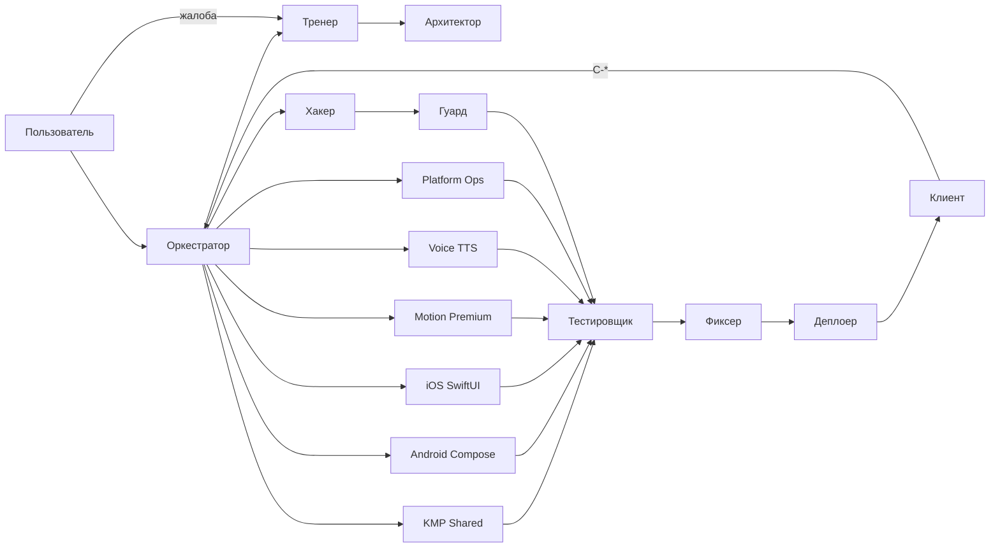

# Team Architecture — Midnight Dancer

Команда агентов для реинжиниринга на **KMP + Jetpack Compose + SwiftUI + SKIE** (+ Flutter TTS Piper до миграции).

Реестр: `.cursor/registry/agents.md`.  
Цикл: `docs/CLIENT_ORCHESTRATOR_CYCLE.md`.  
ТЗ: `tasks/ТЗ на переработку приложения с Flutter на премиальный стек KMP.md`.

## Контуры

**Тренер** — meta: skills/rules/MCP/plugins каждый ход; не путать с вкладкой Trainer / Voice TTS.

## Что делает команду сильной

| Слой | Где лежит |
|------|-----------|
| Rules ролей | `.cursor/rules/` |
| Skills | `.cursor/skills/` + `.agents/skills/` |
| MCP | `.cursor/mcp.json` |
| Plugins | `plugins/` |
| Knowledge | `knowledge/engineering/`, `knowledge/area_midnight_dancer/` |
| Цикл | `docs/CLIENT_ORCHESTRATOR_CYCLE.md`, `promts`, `.cursor/prompts/` |
| Журнал | `memory/_templates/` |

## Жёсткие правила

- Архитектор пишет spec + `chain.md` до кода.
- Оркестратор зовёт роли только по chain (в т.ч. **Voice TTS** по голосам).
- Волны без лимита «3 тикета» (сколько нужно этапу; без overlapping paths).
- Закрытие только с guard.
- Production stores — после Клиента без P0/P1 и явного согласования.
